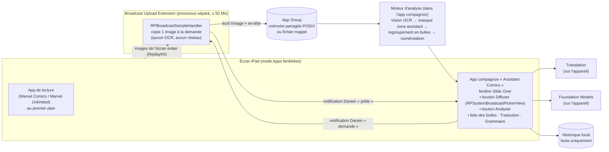
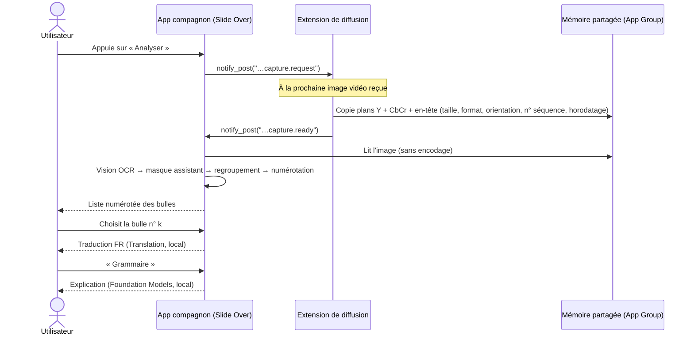

# Assistant Comics — Étude de faisabilité iPad Pro

**Rapport technique : faisabilité uniquement, aucun développement applicatif**
Date : 23 novembre 2026 · Version 1.0

---

## 0. Synthèse

### 0.1 Alerte préalable : Marvel Unlimited va disparaître

Pendant l'étude, une information change le périmètre du projet. **Marvel Unlimited est en cours d'arrêt.**

- Selon la FAQ officielle de Marvel [S29], Marvel Unlimited est « sunset » au **7/12/2026**. Les inscriptions sont fermées depuis le 5/10/2026. Le retrait de l'application est annoncé au **28/12/2026**. Une annonce Marvel cite aussi le 21/12/2026 pour la consultation de la bibliothèque, et les dates intermédiaires divergent selon les sources.
- Une nouvelle application, **« Marvel Comics powered by WEBTOON »**, est sortie le **16/11/2026**. Sur l'App Store, elle s'appelle « Marvel Comics » et demande iPadOS 17.4 ou ultérieur [S30]. On peut y importer sa bibliothèque Marvel Unlimited avant le 7/12/2026, avec un compte WEBTOON. Un nouvel abonnement est nécessaire : la facturation Marvel Unlimited n'est pas transférée [S29].
- La version 1.0.0 de la nouvelle application **avertissait et éjectait l'utilisateur après une capture d'écran** [S31][S32]. Selon les notes de version de l'App Store et la presse, la **version 1.0.1 a levé ces restrictions sur les captures d'écran et l'enregistrement d'écran** [S30][S31].

**Conséquences pour le projet :**

1. La contrainte « pas de dépendance à une application autre que Marvel Unlimited » ne pourra plus être respectée après décembre 2026. Développer spécifiquement pour Marvel Unlimited serait du travail perdu.
2. L'architecture recommandée ici fonctionne avec **n'importe quelle application**, car elle capture l'écran au niveau du système. Changer d'application de lecture ne modifie pas l'architecture, seulement les résultats des tests.
3. **Vous devez décider** s'il faut retenir « Marvel Comics powered by WEBTOON » comme nouvelle application cible. Le protocole de test (§5) la traite comme cible principale et garde Marvel Unlimited tant qu'il fonctionne encore.
4. L'épisode de la version 1.0.0 le prouve : **l'éditeur peut à tout moment, par une simple mise à jour, détecter la capture et masquer le contenu**. C'est un risque structurel, que nous ne contrôlons pas et que nous ne contournerons pas.

### 0.2 Verdict en une phrase

> **GO conditionnel, limité aux tests sans coût (Phases 0 et 1A)**. **NO-GO pour toute dépense ou tout développement complet tant que le test réel n'a pas validé le point critique.** Ce point critique est le suivant : l'application de lecture affiche normalement ses pages pendant une diffusion d'écran système, sans avertissement ni éjection, et la fenêtre Slide Over reste utilisable au-dessus d'elle.

Côté Apple, la documentation ne révèle **aucune impossibilité bloquante**. Chaque brique repose sur une API publique documentée. En revanche, la **priorité absolue n'est pas encore démontrée** : analyser une page sans interrompre la lecture dépend du comportement de l'application de lecture sous capture, et seul un test sur l'iPad peut l'établir.

### 0.3 Matrice exigences → statut

| # | Exigence | Mécanisme retenu | Statut |
|---|---|---|---|
| E1 | Récupérer la page affichée sans interrompre la lecture | Diffusion système ReplayKit + Broadcast Upload Extension | **Mécanisme documenté** ; comportement de l'app de lecture **à tester** (T0.3, T0.4) |
| E2 | Fenêtre flottante déplaçable, redimensionnable, masquable | Slide Over (iPadOS 26.2+, mode « Apps fenêtrées ») | **Documenté (support Apple, lu indirectement)** ; ergonomie avec le lecteur **à tester** (T0.5) |
| E3 | Détecter les bulles et lire le texte anglais | Vision (OCR local) + regroupement géométrique des lignes | OCR **documenté** ; détection des bulles : **aucune API dédiée**, qualité **à tester** (T0.7, Phase 1A) |
| E4 | Liste numérotée, choix d'une bulle | Interface SwiftUI | Aucun risque technique |
| E5 | Traduction française sans modifier la BD | Framework Translation (traitement sur l'appareil) | **Documenté** ; qualité **à tester** |
| E6 | Bouton « Grammaire » | Foundation Models (modèle local Apple Intelligence) | **Documenté** ; dépend du modèle d'iPad ; qualité pédagogique **à tester** |
| E7 | Historique pédagogique | Stockage local (texte uniquement, pas d'images) | Aucun risque technique |
| E8 | Ni jailbreak, ni API privée, ni contournement DRM | API publiques uniquement ; arrêt si l'app protège son contenu | **Respecté par conception** |
| E9 | Développement sans Mac personnel | Mac loué ponctuellement + CI (Xcode Cloud) + TestFlight | **Possible**, Apple Developer Program payant requis (99 USD/an) pour l'extension |

### 0.4 Méthode et niveaux de preuve

Chaque affirmation porte un niveau de preuve :

| Étiquette | Signification |
|---|---|
| **[DOC]** | Documentation officielle Apple **lue directement** (developer.apple.com) |
| **[OFF\*]** | Source officielle (Apple Support, Marvel, App Store, éditeurs CI) dont le contenu a été obtenu **par un moteur de recherche**. L'environnement d'étude n'a pas pu charger ces pages directement (accès réseau refusé). **À reconfirmer** avant toute décision d'achat. |
| **[PRESSE]** / **[COMM]** | Presse spécialisée / forums communautaires (non officiels) |
| **[HYP]** | Hypothèse ou estimation **non vérifiée**, à mesurer |

Aucun test n'a pu être exécuté sur un iPad pendant cette étude. **Aucune fonctionnalité n'est présentée comme validée sur l'appareil.**

---

## 1. Fonctionnalités confirmées par la documentation officielle

### 1.A Capture d'écran (ReplayKit)

| # | Fait confirmé | Source |
|---|---|---|
| C1 | ReplayKit permet de construire des **extensions de diffusion en direct** (« app extensions for live broadcasting »). | [DOC] [S1] |
| C2 | Une sous-classe de `RPBroadcastSampleHandler` reçoit les images vidéo (`CMSampleBuffer`) dans `processSampleBuffer(_:with:)`. Les appels sont **séquentiels**. Le tampon n'est **valide que jusqu'au retour de la méthode** : il faut le copier pour le conserver. | [DOC] [S2][S3] |
| C3 | `RPSystemBroadcastPickerView` (iOS 12+) affiche **dans notre application** un bouton qui ouvre le sélecteur de diffusion. `preferredExtension` le limite à notre extension. | [DOC] [S4] |
| C4 | La diffusion système se lance depuis le Centre de contrôle ou le sélecteur. Elle **continue quand l'utilisateur passe d'une application à l'autre**, ce qui est sa finalité (diffuser l'écran entier). | [OFF\*] WWDC18 « Live Screen Broadcast with ReplayKit » [S6] |
| C5 | `RPScreenRecorder` (`startRecording` / `startCapture`) enregistre **« audio and video of your app »**, c'est-à-dire **uniquement notre propre application**. Cette voie **ne permet pas** de voir Marvel Unlimited ou Marvel Comics. | [DOC] [S5] |
| C6 | Le système **noircit les vidéos chiffrées FairPlay** lors des enregistrements, recopies et AirPlay. « ReplayKit is incompatible with AVPlayer content. » Cela concerne la **vidéo**, pas les images d'une BD. | [DOC] [S1][S7] |
| C7 | Une application **peut détecter** qu'elle est capturée : `UIScreen.isCaptured` couvre enregistrement, recopie et AirPlay, et `UITraitCollection.sceneCaptureState` existe depuis iOS 17. Apple écrit : *« Observe this property and optionally take an appropriate action in your app to prevent the capture of your content »*. **Une application de lecture peut donc légitimement masquer ses pages pendant une diffusion.** | [DOC] [S7][S8] |
| C8 | Une application est notifiée **après** chaque capture d'écran (`userDidTakeScreenshotNotification`). C'est ce mécanisme qui permettait à Marvel Comics 1.0.0 d'avertir et d'éjecter. | [DOC] [S9] + [PRESSE] [S31] |
| C9 | Chaque image vidéo porte son orientation (`RPVideoSampleOrientationKey`). | [DOC] [S2] |

**Distinction demandée (§3.A du cahier des charges) :**

| | Capture de **sa propre application** | Diffusion de **l'écran entier** |
|---|---|---|
| API | `RPScreenRecorder.startCapture` / `startRecording` | Broadcast Upload Extension (`RPBroadcastSampleHandler`) lancée via `RPSystemBroadcastPickerView` ou le Centre de contrôle |
| Voit Marvel Comics / Marvel Unlimited ? | **Non** [DOC] | **Oui en principe** [DOC/OFF\*] : c'est l'écran entier. Le contenu effectivement visible dépend de l'application capturée (C7). |
| Processus | Notre application | Extension séparée, exécutée en arrière-plan pendant que l'autre application est au premier plan |
| Utilisable pour le projet | Non | **Oui : seule voie publique** |

### 1.B Affichage flottant (multitâche iPadOS)

| # | Fait confirmé | Source |
|---|---|---|
| C10 | **iPadOS 26.2 ou ultérieur** : on peut faire d'**une** fenêtre une fenêtre **Slide Over**, qui **reste ouverte au-dessus** des autres. Il faut activer le mode **« Windowed Apps »** (Apps fenêtrées) dans les réglages Multitâche et gestes. On l'ouvre par le bouton de contrôle de fenêtre (« Enter Slide Over ») ou en glissant une app vers le bord de l'écran. On peut la **redimensionner**, la **chasser hors de l'écran** et la **rappeler** d'un glissement depuis le bord. | [OFF\*] Apple Support « Multitask on iPad » [S11] |
| C11 | Slide Over est revenu dans iPadOS 26.1 (après sa suppression dans 26.0), avec **une seule** application Slide Over à la fois, et **uniquement en mode Apps fenêtrées**. | [PRESSE] [S12] |
| C12 | En mode Apps fenêtrées d'iPadOS 26, **même une application qui refuse le multitâche** (`UIRequiresFullScreen`) peut partager l'écran avec d'autres applications : le système la met à l'échelle au lieu de la redimensionner. | [DOC] [S10] |
| C13 | Une application peut afficher du contenu personnalisé dans une fenêtre **Picture in Picture** flottante (`AVPictureInPictureController.ContentSource` avec `AVSampleBufferDisplayLayer`, iOS 15+). C'est une alternative d'affichage, **non interactive** (voir L13). | [DOC] [S19] |

### 1.C Communication entre composants

| # | Fait confirmé | Source |
|---|---|---|
| C14 | Les **App Groups** donnent un **conteneur partagé** entre une application et **son extension**. Ils permettent aussi l'**IPC** : Mach IPC, XPC, **sémaphores POSIX et mémoire partagée POSIX**, **sockets UNIX** (fichier de socket dans le conteneur partagé). Le nom d'un segment de mémoire partagée prend la forme `<group id>/<nom>` et ne doit pas dépasser `PSHMNAMLEN` caractères. | [DOC] [S13][S14] |
| C15 | Les **notifications Darwin** (`notify.h` / `CFNotificationCenterGetDarwinNotifyCenter`) sont **à l'échelle du système** et sans charge utile. Elles servent de « sonnette » entre processus. | [DOC] [S15] |
| C16 | La capacité **App Groups est disponible même avec un compte Apple Developer gratuit** (équipe personnelle). | [DOC] [S20] |

### 1.D Analyse locale (OCR, traduction, grammaire)

| # | Fait confirmé | Source |
|---|---|---|
| C17 | Vision reconnaît le texte d'une image : `VNRecognizeTextRequest` (iOS 13+) et `RecognizeTextRequest` (iOS 18+). On peut fixer les langues, le niveau de précision, la correction linguistique et des mots personnalisés (`customWords`, par exemple les noms de personnages). Chaque résultat fournit le texte **et sa position** dans l'image. | [DOC] [S16] |
| C18 | Translation : *« All translations using the TranslationSession class are processed on the user's device »*. Depuis **iOS 26**, `TranslationSession(installedSource:target:)` s'utilise **sans interface**, à condition que les langues soient déjà téléchargées. | [DOC] [S17] |
| C19 | Foundation Models (iOS 26+) donne accès au modèle de langage **sur l'appareil** d'Apple Intelligence. Il est multilingue (toutes les langues d'Apple Intelligence) et **exige un appareil compatible Apple Intelligence**. Sa disponibilité se vérifie par `SystemLanguageModel.default.availability`. | [DOC] [S18] |
| C20 | Live Text fonctionne sur une **vidéo mise en pause** dans Photos (iPadOS 16+). On peut donc tester gratuitement l'OCR système sur un enregistrement d'écran. | [OFF\*] [S28] |

### 1.E Outillage et comptes

| # | Fait confirmé | Source |
|---|---|---|
| C21 | Swift Playgrounds permet d'écrire, d'exécuter et de soumettre (App Store/TestFlight) des applications SwiftUI **depuis l'iPad**. Sa liste officielle de capacités (caméra, photos, localisation…) **ne contient ni App Groups ni cibles d'extension**. | [DOC] [S23] |
| C22 | Swift Playgrounds **4.7** est sorti en mars 2026, en réponse aux demandes de prise en charge du SDK 26 (réponses d'un ingénieur Apple DTS). Le SDK exact embarqué n'est pas précisé. | [COMM, réponses Apple] [S24] |
| C23 | Compte gratuit : test sur appareil **via Xcode**, 10 App IDs et 3 appareils, profils **valables 7 jours**, 3 apps par appareil. **TestFlight, App Store Connect et Xcode Cloud exigent l'Apple Developer Program.** | [DOC] [S21] |
| C24 | Apple Developer Program : **99 USD/an**, « en devise locale le cas échéant ». | [DOC] [S22] |
| C25 | Xcode Cloud : **25 h de calcul par mois incluses** dans l'Apple Developer Program. **La configuration initiale se fait dans Xcode** (« Use Xcode to initially configure your project »). | [OFF\*] [S27] ; [DOC] [S26] |

---

## 2. Fonctionnalités incertaines nécessitant un test réel

| # | Incertitude | Pourquoi c'est incertain | Test |
|---|---|---|---|
| **U1** | **L'application de lecture affiche-t-elle ses pages pendant une diffusion système ?** Pas d'écran noir, pas d'avertissement, pas d'éjection. | Elle peut le faire légitimement (C7). Marvel Comics 1.0.0 réagissait aux captures, 1.0.1 a levé la restriction [S30][S31]. Le comportement **peut changer à chaque mise à jour**. | **T0.3, T0.4** (critique) |
| U2 | Le comportement est-il identique pour un enregistrement d'écran natif et pour une diffusion vers une extension tierce ? | `isCaptured` ne distingue pas les deux [DOC], mais l'application peut réagir différemment. | T0.3 vs T0.4 |
| U3 | Quelle résolution et quel format de pixel ReplayKit livre-t-il sur **votre** iPad Pro ? | Non documenté. Ordre de grandeur **[HYP]** : si la résolution native est livrée, 2752×2064 (13" M4) en YUV 4:2:0 ≈ **8,5 Mo** par image, et ≈ 22,7 Mo en BGRA. | T1.3 |
| U4 | **Limite mémoire de l'extension ≈ 50 Mo**, avec des plantages rapportés sur iPad à cause des grandes images | Chiffre **communautaire** [COMM] [S25][S39]. Aucune confirmation Apple trouvée. | T1.2 |
| U5 | ReplayKit envoie-t-il des images quand l'écran est **statique** (page immobile) ? | Comportement non documenté. | T1.5 |
| U6 | Slide Over au-dessus de l'application de lecture : la lecture reste-t-elle fluide ? Le geste de rappel **entre-t-il en conflit avec le glissement de page** ? Comment se comporte-t-il sous iPadOS 27.x ? | Documentation 26.2 seulement [OFF\*]. Aucune source officielle trouvée sur un changement de Slide Over en 27.x. | T0.5 |
| U7 | **La fenêtre de l'assistant apparaît dans la capture.** C'est l'écran entier, donc elle peut masquer des bulles. | Conséquence logique de C4 ; l'ampleur dépend de la disposition. | T0.8, T1.6 |
| U8 | La diffusion **survit-elle** à : masquer et rappeler Slide Over, rotation, verrouillage automatique, changement d'app, 30 à 60 min de lecture ? Impact sur la batterie et la chauffe ? | Non documenté. | T0.6, T1.7, T1.8 |
| U9 | **Qualité de l'OCR sur le lettrage de comics** : majuscules, police manuscrite, gras, onomatopées, bulles en italique | Vision est conçu pour du texte général ; aucune donnée publique sur les comics. | T0.7, Phase 1A |
| U10 | **Découpage en bulles** par regroupement des lignes OCR | Pas d'API Apple de détection de bulles. Il faut une heuristique, voire plus tard un modèle Core ML. | Phase 1A |
| U11 | Latence « Analyser → liste des bulles » < 2 s | Somme de copie d'image, OCR et regroupement : à mesurer. | T1.4 |
| U12 | Qualité de la traduction anglais → français hors ligne, et pertinence pédagogique des explications grammaticales du modèle local | Qualité non garantie, surtout pour l'argot des comics. | Phase 1A |
| U13 | Votre iPad Pro est-il **compatible Apple Intelligence** (Foundation Models) ? | Dépend du modèle (puce M) et de la région. | T0.1 |
| U14 | Le **SDK de Swift Playgrounds 4.7** expose-t-il Translation (init iOS 26) et Foundation Models ? | Non précisé par Apple [S24]. | Phase 1A |
| U15 | En paysage, l'application de lecture laisse-t-elle des **marges latérales** où placer l'assistant sans couvrir la page ? | Dépend du lecteur et du mode (page simple, double page, lecture guidée). | T0.8 |

---

## 3. Limitations et impossibilités identifiées

| # | Limitation | Nature | Conséquence |
|---|---|---|---|
| **L1** | **Marvel Unlimited s'arrête** : accès jusqu'au 7/12/2026, retrait le 28/12/2026 [S29]. | **Impossibilité** de respecter durablement la contrainte « Marvel Unlimited uniquement » | Recibler vers « Marvel Comics powered by WEBTOON » : **décision à prendre par vous** |
| **L2** | `RPScreenRecorder` ne capture que **sa propre application** [S5]. | Impossibilité | Seule la Broadcast Upload Extension convient |
| **L3** | Aucune API publique ne permet à une application tierce de lire le **texte** ou la **vue** d'une autre application (bac à sable iOS). | Impossibilité | L'analyse passe par les **pixels + OCR** |
| **L4** | La diffusion doit être **lancée explicitement par l'utilisateur** (bouton du sélecteur ou Centre de contrôle) [S4][S6]. | Limitation | Un geste par session de lecture, pas de démarrage automatique |
| **L5** | La capture prend **tout l'écran** : l'assistant lui-même, les notifications, les autres fenêtres. | Limitation | Masquage de la zone de l'assistant ; mode Concentration conseillé pendant la lecture |
| **L6** | **L'éditeur peut détecter la capture et masquer le contenu** à tout moment (C7, C8). Il l'a déjà fait dans Marvel Comics 1.0.0. | **Risque structurel non maîtrisable** | Si cela arrive, **arrêt** : pas de contournement (contrainte DRM) |
| L7 | Mémoire de l'extension limitée (≈ 50 Mo selon la communauté) | Limitation | **Pas d'OCR dans l'extension** : elle copie seulement l'image |
| L8 | Swift Playgrounds : **pas d'extension, pas d'App Groups** [S23] | Impossibilité (pour la capture) | Xcode est indispensable pour la partie capture |
| L9 | Windows 11 : pas de Xcode. Une machine virtuelle macOS sur PC est **contraire à la licence macOS** (virtualisation réservée au matériel Apple). | Impossibilité | Mac **loué** (cloud) ou CI macOS |
| L10 | Compte gratuit : l'installation passe par Xcode avec l'iPad **connecté au Mac**, ce qui est irréalisable avec un Mac distant. TestFlight exige le programme payant [S21]. | Limitation | **99 USD/an** nécessaires pour tester l'extension sur l'iPad. Les outils tiers de « sideload » sous Windows existent mais ne sont pas officiels : **non recommandés** |
| L11 | Mac distant : **pas de câble vers l'iPad**, donc pas de débogueur ni d'Instruments en direct sur l'extension. | Limitation | Instrumentation intégrée (compteurs, mémoire, temps) affichée dans l'assistant |
| L12 | Slide Over : **une seule** fenêtre, **uniquement en mode Apps fenêtrées** [S11][S12] | Limitation | Utiliser le mode Apps fenêtrées pendant la lecture |
| L13 | Picture in Picture : affichage **non interactif** (contrôles système seulement) | Limitation | Option d'appoint (afficher une traduction), pas d'interface principale |
| L14 | Conditions d'utilisation : service réservé à un « **personal, noncommercial use** » [S33] | Contrainte juridique | Traitement en mémoire, **aucune image stockée ni partagée**, historique limité au texte des bulles choisies. Usage personnel (TestFlight), pas de publication sur l'App Store. Relire les CGU WEBTOON de la nouvelle application. *(Ceci n'est pas un avis juridique.)* |

---

## 4. Architecture minimale recommandée

### 4.1 Composants



| Composant | Rôle | Technologies | Points d'attention |
|---|---|---|---|
| **App compagnon** | Interface flottante, démarrage et arrêt de la diffusion, orchestration | SwiftUI, cycle de vie à scènes, redimensionnable (sans `UIRequiresFullScreen`), `RPSystemBroadcastPickerView` | Vit dans Slide Over ; elle est au premier plan quand l'utilisateur appuie sur « Analyser » |
| **Broadcast Upload Extension** | Recevoir les images ; sur demande, **copier une seule image** dans la zone partagée | ReplayKit, CoreVideo, `notify.h` | **Budget mémoire** : une copie d'image, aucun traitement lourd, aucune persistance, aucun réseau |
| **Zone partagée** | Transmettre l'image sans encodage | App Group + mémoire partagée POSIX (`shm_open`, nom court ≤ `PSHMNAMLEN`) **ou** fichier mappé (`mmap`) dans le conteneur | Double tampon + numéro de séquence (ou sémaphore POSIX) pour éviter une image à moitié écrite |
| **Moteur d'analyse** | OCR → bulles → liste numérotée | Vision (`RecognizeTextRequest`, langue `en-US`, niveau précis, `customWords`) | Écarter la zone occupée par l'assistant (§4.3) ; ordre de lecture haut→bas puis gauche→droite |
| **Traduction** | Bulle choisie → français | `TranslationSession(installedSource:target:)` | Télécharger les langues une fois (via `.translationTask`) |
| **Grammaire** | Explication : temps, constructions, expressions | Foundation Models (`LanguageModelSession`, sortie structurée `@Generable`) | Repli si l'appareil n'est pas compatible : explications plus simples ou service distant **sur option uniquement** |
| **Historique** | Progression pédagogique | SwiftData / fichier local | Texte des bulles choisies, traduction, notes ; **jamais d'image** |

### 4.2 Séquence « Analyser » et budget de latence



| Étape | Objectif **[HYP, à mesurer]** |
|---|---|
| Demande → image disponible | < 200 ms |
| OCR + regroupement (page entière) | < 1,5 s |
| **Total « Analyser » → liste** | **< 2 s** (critère GO) |
| Traduction d'une bulle | < 1 s |
| Explication grammaticale | < 5 s |

**Repli pour l'écran statique (U5)** : si aucune image n'arrive dans les 300 ms, l'extension renvoie la dernière image mise en cache. Ce cache est rafraîchi au plus à 1 image/s, et seulement si la mémoire mesurée le permet. La mise à jour visuelle du bouton « Analyser » modifie l'écran, ce qui devrait suffire à déclencher une nouvelle image. **[HYP]**

### 4.3 Gérer la fenêtre de l'assistant présente dans la capture (U7)

Trois mesures cumulables, sans aucune API privée :

1. **Disposition** : en paysage, une page de comics au format portrait laisse en général des marges latérales. L'assistant s'y place sans rien couvrir (à vérifier, T0.8).
2. **Repères visuels** : l'assistant dessine un liseré de couleur distinctive (ou de petits motifs aux coins). Le moteur repère ce rectangle dans l'image et **ignore tout texte qu'il contient**, y compris le texte de l'assistant lui-même.
3. **Signalement** : si des lignes OCR sont coupées par le bord de l'assistant, l'interface propose de déplacer la fenêtre et de relancer l'analyse.

### 4.4 Esquisse de l'extension *(illustrative, non compilée)*

```swift
import ReplayKit
import CoreVideo
import Darwin // notify_post / notify_register_dispatch (notify.h)

final class SampleHandler: RPBroadcastSampleHandler {
    private var captureRequested = false // NB : drapeau partagé entre files, à protéger par un verrou
    private var token: Int32 = 0
    private let shared = SharedFrameBuffer(groupID: "group.cc.coach", name: "f") // shm/mmap, double tampon

    override func broadcastStarted(withSetupInfo setupInfo: [String : NSObject]?) {
        notify_register_dispatch("cc.coach.capture.request", &token, .main) { [weak self] _ in
            self?.captureRequested = true
        }
    }

    override func processSampleBuffer(_ sb: CMSampleBuffer, with type: RPSampleBufferType) {
        guard type == .video, captureRequested,
              let px = CMSampleBufferGetImageBuffer(sb) else { return }
        captureRequested = false
        let orientation = CMGetAttachment(sb, key: RPVideoSampleOrientationKey as CFString,
                                          attachmentModeOut: nil)
        shared.write(pixelBuffer: px, orientation: orientation) // copie des plans AVANT le retour (C2)
        notify_post("cc.coach.capture.ready")
    }

    override func broadcastFinished() { notify_cancel(token) }
}
```

La Phase 1B doit aussi enregistrer dans l'en-tête partagé : l'**empreinte mémoire** de l'extension (`task_vm_info.phys_footprint`), la **résolution**, le **format de pixel**, le **nombre d'images reçues** et les **horodatages**. L'assistant les affiche dans un écran « Diagnostic », ce qui compense l'absence de débogueur (L11).

---

## 5. Protocole de test concret sur iPad Pro

### Phase 0 — Aucune dépense, aucun développement (≈ 1 h 30)

**Objectif** : prouver avec les outils intégrés que le point critique (E1, E2) est atteignable **avant** de dépenser quoi que ce soit.
**Application cible** : « Marvel Comics powered by WEBTOON », à jour (version ≥ 1.0.1). Ajoutez Marvel Unlimited **seulement** si l'accès fonctionne encore (avant le 7/12/2026).

| Test | Procédure | Mesure / observation | Critère de réussite |
|---|---|---|---|
| **T0.1 Inventaire** | Réglages > Général > Informations ; Réglages > Apple Intelligence ; App Store > versions | Modèle exact de l'iPad Pro, version d'iPadOS, Apple Intelligence disponible (oui/non), version de l'application de lecture | Informations relevées |
| **T0.2 Préparation** | Réglages > Multitâche et gestes > mode **Windowed Apps** (Apps fenêtrées ; le libellé français peut différer). Activer un mode Concentration. | — | Mode actif |
| **T0.3 Enregistrement natif** ⭐ | Centre de contrôle > Enregistrement de l'écran. Lire 3 pages : tourner les pages, zoomer, essayer la lecture guidée (« Smart Panel ») si elle existe, ouvrir un numéro **téléchargé hors ligne**. Arrêter, puis revoir la vidéo dans Photos. | Avertissement ? Éjection ? Pages noires ou floutées ? Pages lisibles dans la vidéo ? | **Pages visibles et nettes, aucun avertissement ni éjection** |
| **T0.4 Extension tierce** ⭐ | Optionnel mais très probant. Avec une application de visioconférence gratuite déjà installée qui partage l'écran iOS par diffusion (Teams, Zoom, Meet…) : réunion **seul**, rejoindre depuis le PC, lancer le partage d'écran de l'iPad, puis ouvrir l'application de lecture. Court, **sans enregistrement**. | La page apparaît-elle sur le PC ? | **Page visible sur le PC.** Cela prouve qu'une *Broadcast Upload Extension tierce* reçoit les images pendant que l'application de lecture est au premier plan. |
| **T0.5 Slide Over** ⭐ | Application de lecture en fenêtre agrandie. Une application de remplacement (Notes ou Traduire) en Slide Over (bouton de fenêtre > « Enter Slide Over »). Tourner 10 pages ; masquer et rappeler Slide Over 10 fois ; redimensionner ; tester en portrait et en paysage. | La lecture reste-t-elle fluide ? Conflit entre le glissement de page et le geste de Slide Over ? Temps pour masquer et rappeler ? L'application de lecture est-elle mise à l'échelle (C12) ? | **Lecture possible avec Slide Over visible et masqué, sans gêne majeure** |
| **T0.6 Endurance** | T0.3 + T0.5 combinés pendant **15 min** ; puis changer d'application, laisser l'écran se verrouiller, déverrouiller. | L'enregistrement continue-t-il ? S'arrête-t-il au verrouillage ? Batterie avant/après | Enregistrement continu en lecture normale |
| **T0.7 Qualité OCR (approximation)** | Dans Photos, mettre la vidéo en pause sur 5 pages ; Live Text (« Détecter le texte ») ; sélectionner le texte de chaque bulle ; le comparer au texte réel ; traduire 5 bulles avec Traduire. | % de bulles lues sans erreur gênante ; erreurs typiques (I/1, apostrophes, mots coupés) | **≥ 90 % des bulles de dialogue exploitables** |
| **T0.8 Disposition** | En paysage, noter si la page laisse des marges latérales ; placer Slide Over dans la marge. | Largeur libre ; une bulle est-elle couverte ? | Au moins une disposition où l'assistant ne couvre aucune bulle |
| **Nettoyage** | **Supprimer les enregistrements** après les tests (CGU, L14). | — | — |

**Porte de décision G0 :**

- T0.3 **ou** T0.4 en échec (noir, avertissement, éjection) → **NO-GO** pour cette application de lecture. Pas de contournement.
- T0.5 en échec → tester la juxtaposition de deux fenêtres côte à côte (mode fenêtré). Si c'est aussi inacceptable → **NO-GO** sur l'exigence « fenêtre flottante ».
- T0.3, T0.5 réussis (et T0.4 si réalisé), T0.7 ≥ 80 % → **GO Phase 1A**.

### Phase 1A — Prototype du moteur d'analyse dans Swift Playgrounds (0 €)

**Objectif** : valider OCR, découpage en bulles, traduction et grammaire **sur l'iPad**, sans extension.

1. Dans Swift Playgrounds 4.7, créer une app qui charge **les vidéos d'enregistrement de la Phase 0** (PhotosPicker) et en **extrait automatiquement des images** (AVFoundation, `AVAssetImageGenerator`). Aucune capture manuelle n'est nécessaire.
2. OCR avec Vision, regroupement des lignes en bulles, liste numérotée, mesure du temps par page.
3. Si le SDK le permet (U14) : traduction avec Translation et explication avec Foundation Models.
4. Jeu d'essai : 20 pages variées (dialogues, narration, onomatopées, pages sombres). Les données restent locales et sont supprimées après le test.

| Mesure | Critère |
|---|---|
| Bulles correctement délimitées | ≥ 85 % |
| Texte exact (après correction linguistique) | ≥ 90 % des bulles |
| Temps OCR + regroupement par page | < 1,5 s |
| Traduction jugée compréhensible | ≥ 90 % des bulles testées |
| Explication grammaticale jugée juste et utile | Évaluation sur 20 phrases |

**Porte G1** : critères atteints → GO Phase 1B (**première dépense** : 99 USD).

### Phase 1B — Preuve de concept capture + analyse (Xcode, programme payant)

À ne lancer qu'après G0 et G1.

1. **Mise en place (1 journée de Mac loué)** : créer le projet (app + Broadcast Upload Extension), configurer App Group et signature, créer la fiche App Store Connect, faire un premier envoi TestFlight, **configurer Xcode Cloud** (obligatoirement depuis Xcode, C25).
2. **Itérations** : le code est poussé sur GitHub depuis le PC (ou par un agent de code). Xcode Cloud compile et distribue sur TestFlight, puis on installe sur l'iPad.

| Test | Procédure | Critère GO |
|---|---|---|
| T1.1 Réception | Lancer la diffusion depuis l'assistant (Slide Over) ; application de lecture au premier plan ; compteur d'images affiché dans l'écran Diagnostic | Les images arrivent pendant la lecture |
| T1.2 Mémoire | Empreinte de l'extension relevée toutes les 5 s pendant 30 min | Pic < 40 Mo, **aucun arrêt forcé** |
| T1.3 Format | Résolution, format de pixel, orientation relevés | Documentés (pour dimensionner) |
| **T1.4 Latence** ⭐ | 20 appuis sur « Analyser » sur des pages différentes ; horodatages à chaque étape | **Médiane < 2 s**, 95e centile < 3 s |
| T1.5 Écran statique | « Analyser » après 30 s sans toucher l'écran | Image obtenue (directe ou en cache) |
| T1.6 Masquage | Assistant placé volontairement sur la page | Aucun texte de l'assistant dans la liste ; bulles couvertes signalées |
| T1.7 Robustesse | Masquer et rappeler Slide Over, rotation, verrouillage, changement d'app, mode économie d'énergie | Diffusion conservée, ou reprise en 1 geste avec message clair |
| T1.8 Énergie | 30 min de lecture avec et sans diffusion | Écart de batterie jugé acceptable par l'utilisateur |
| **T1.9 Lecture non interrompue** ⭐ | Lire un numéro complet en utilisant l'assistant au moins 10 fois | **Aucune sortie de l'application de lecture**, aucun avertissement de l'éditeur |

**GO final** = T1.1, T1.2, T1.4 et T1.9 réussis. Tout échec de T1.9 dû à une protection de l'éditeur entraîne un **NO-GO définitif pour cette application**.

### Fiche de relevé (à copier)

| Date | iPad / iPadOS | App lecture + version | Test | Résultat (OK/KO) | Mesures | Remarques |
|---|---|---|---|---|---|---|
| | | | | | | |

---

## 6. Outils nécessaires et coûts

### 6.1 Ce que chaque outil permet

| Outil | Peut faire | Ne peut pas faire |
|---|---|---|
| **Agent de code (Codex, Claude Code…) sous Linux ou Windows** | Écrire le code Swift/SwiftUI, l'extension, la configuration du projet (XcodeGen/Tuist), les workflows CI ; tester la **logique pure** (regroupement des bulles) avec la chaîne Swift pour Linux ou Windows | **Compiler une app iOS ou une extension**, signer, installer sur l'iPad : Xcode et le SDK iOS n'existent que sous macOS |
| **Swift Playgrounds 4.7 (iPad, gratuit)** | Prototyper et exécuter **sur l'iPad** l'interface et le moteur d'analyse (Vision ; Translation et Foundation Models si le SDK le permet) ; envoyer vers TestFlight (avec le programme payant) | **Broadcast Upload Extension, App Groups** [S23] : donc **aucune capture d'une autre application** |
| **Xcode (Mac loué)** | Tout : cibles d'extension, droits, signature, archive, TestFlight, configuration initiale de Xcode Cloud | Débogage et Instruments **en direct** sur l'iPad (pas de câble, L11) |
| **Xcode Cloud** | Compiler, archiver, distribuer sur TestFlight à chaque push | Configuration initiale sans Xcode |
| **TestFlight (iPad)** | Installer les versions de test | — (programme payant requis) |

### 6.2 Coûts

| Poste | Phase | Coût | Source / fiabilité |
|---|---|---|---|
| iPad Pro, PC Windows 11 | toutes | 0 € (déjà possédés) | — |
| Abonnement à l'application de lecture (Marvel Comics / WEBTOON) | toutes | Nouvel abonnement nécessaire, tarif annoncé proche de Marvel Unlimited. **Coût de lecture, pas du projet.** | [OFF\*] [S29] / [PRESSE] |
| Enregistrement d'écran, Live Text, Traduire, Notes | 0 | 0 € | Intégrés à iPadOS |
| Visioconférence (T0.4, optionnel) | 0 | 0 € (offre gratuite) | — |
| Swift Playgrounds 4.7 | 1A | 0 € | [DOC] |
| **Apple Developer Program** | 1B | **99 USD/an** (montant en euros affiché à l'inscription) | [DOC] [S22] |
| Mac loué pour la mise en place — **Scaleway** Mac mini (Paris) | 1B | M1 ≈ 0,11 €/h, M4 ≈ 0,22 €/h, **minimum 24 h** → ≈ **2,6 € à 5,3 €** la journée | [OFF\*] [S36] |
| Alternative : **MacinCloud** paiement à l'usage | 1B | ≈ 1 USD/h, crédit prépayé, sans droits administrateur | [OFF\*/tiers] [S37] |
| Alternative : **AWS EC2 Mac** (mac2.metal) | 1B | ≈ 0,65 USD/h, minimum 24 h → ≈ 15,6 USD | [OFF\*] [S38] |
| **Xcode Cloud** | 1B+ | 25 h/mois **incluses** dans le programme payant | [OFF\*] [S27] |
| Alternatives CI : Codemagic (500 min macOS/mois gratuites, compte personnel) ; GitHub Actions (macOS 0,062 USD/min au-delà du quota inclus ; gratuit pour un dépôt public) | 1B+ | 0 € dans les quotas | [OFF\*] [S35][S34] |

**Total avant décision GO (Phases 0 et 1A) : 0 €.**
**Total Phase 1B : ≈ 99 USD/an + ≈ 3 à 6 €** (une journée Scaleway), puis 0 € en itération avec Xcode Cloud.

---

## 7. Conclusion GO / NO-GO

### Ce que la documentation prouve

- La **seule** voie publique pour obtenir l'image d'une autre application est la **diffusion système ReplayKit vers une Broadcast Upload Extension**. Elle est conçue pour capturer l'écran entier en continu pendant que l'utilisateur change d'application (C1–C4). La capture d'application (`RPScreenRecorder`) ne convient pas (C5).
- Le transfert extension → application est couvert par des mécanismes **documentés** (App Groups, mémoire partagée POSIX, notifications Darwin ; C14–C16).
- L'OCR, la traduction et la génération d'explications existent **sur l'appareil** (C17–C19). Cela respecte la préférence pour le traitement local.
- Slide Over (iPadOS 26.2+) fournit une fenêtre **flottante, redimensionnable et masquable par glissement** (C10). Une application de lecture qui refuse le multitâche peut quand même cohabiter en mode fenêtré (C12).
- Il est possible de développer **sans acheter de Mac** : Mac loué pour la mise en place, puis Xcode Cloud et TestFlight. En revanche, **Swift Playgrounds seul ne peut pas réaliser la capture** (C21).

### Ce qui n'est pas prouvé (et bloque un GO complet)

1. **L'application de lecture laisse-t-elle voir ses pages pendant la capture ?** (U1). C'est le cœur de la priorité absolue. L'API le permet techniquement, mais l'éditeur peut l'empêcher. Il l'a déjà fait au lancement de la nouvelle application, puis a fait marche arrière en 1.0.1.
2. **L'ergonomie de Slide Over au-dessus du lecteur** (U6, U7).
3. **La qualité de l'OCR et du découpage en bulles sur le lettrage de comics** (U9, U10).

### Verdict

| Périmètre | Décision | Justification |
|---|---|---|
| Développer pour **Marvel Unlimited** spécifiquement | **NO-GO** | Application arrêtée le 7/12/2026 et retirée le 28/12/2026 [S29] |
| Concept appliqué à **Marvel Comics powered by WEBTOON** — Phases 0 et 1A | **GO** | Aucune impossibilité côté Apple ; tests gratuits et rapides ; ils lèvent les incertitudes critiques |
| Dépense de 99 USD et PoC avec extension (Phase 1B) | **En attente** : GO seulement si G0 et G1 sont franchis | Ne pas dépenser avant la preuve sur l'appareil (contrainte du cahier des charges) |
| Application complète | **NO-GO à ce stade** | Hors mission ; dépend du GO final de la Phase 1B |

**Risque résiduel majeur, même après un GO** : l'éditeur peut réintroduire une protection contre la capture dans une mise à jour (L6). Le projet ne doit donc pas investir au-delà d'un usage personnel. L'architecture reste indépendante de l'application de lecture pour limiter cette dépendance.

### Décisions attendues de votre part

1. **Valider le changement d'application cible** : Marvel Unlimited → Marvel Comics powered by WEBTOON.
2. **Exécuter la Phase 0** (≈ 1 h 30) et remplir la fiche de relevé. Les résultats permettront de trancher G0.

---

## Annexe — Sources

| Réf. | Source | Niveau |
|---|---|---|
| S1 | ReplayKit — https://developer.apple.com/documentation/replaykit | DOC |
| S2 | RPBroadcastSampleHandler — https://developer.apple.com/documentation/replaykit/rpbroadcastsamplehandler | DOC |
| S3 | processSampleBuffer(_:with:) — https://developer.apple.com/documentation/replaykit/rpbroadcastsamplehandler/processsamplebuffer(_:with:) | DOC |
| S4 | RPSystemBroadcastPickerView — https://developer.apple.com/documentation/replaykit/rpsystembroadcastpickerview | DOC |
| S5 | RPScreenRecorder — https://developer.apple.com/documentation/replaykit/rpscreenrecorder | DOC |
| S6 | WWDC18 « Live Screen Broadcast with ReplayKit » — https://developer.apple.com/videos/play/wwdc2018/601/ | OFF\* |
| S7 | UIScreen.isCaptured — https://developer.apple.com/documentation/uikit/uiscreen/iscaptured | DOC |
| S8 | UITraitCollection.sceneCaptureState — https://developer.apple.com/documentation/uikit/uitraitcollection/scenecapturestate | DOC |
| S9 | userDidTakeScreenshotNotification — https://developer.apple.com/documentation/uikit/uiapplication/userdidtakescreenshotnotification | DOC |
| S10 | UIRequiresFullScreen — https://developer.apple.com/documentation/bundleresources/information-property-list/uirequiresfullscreen | DOC |
| S11 | Apple Support, « Multitask on iPad » — https://support.apple.com/en-us/125309 | OFF\* |
| S12 | MacRumors, iPadOS 26.1 et Slide Over — https://www.macrumors.com/2025/11/03/apple-releases-ipados-26-1/ | PRESSE |
| S13 | App Groups Entitlement — https://developer.apple.com/documentation/bundleresources/entitlements/com.apple.security.application-groups | DOC |
| S14 | Configuring app groups — https://developer.apple.com/documentation/xcode/configuring-app-groups | DOC |
| S15 | CFNotificationCenterGetDarwinNotifyCenter — https://developer.apple.com/documentation/corefoundation/cfnotificationcentergetdarwinnotifycenter() | DOC |
| S16 | Vision RecognizeTextRequest — https://developer.apple.com/documentation/vision/recognizetextrequest ; VNRecognizeTextRequest — https://developer.apple.com/documentation/vision/vnrecognizetextrequest | DOC |
| S17 | TranslationSession — https://developer.apple.com/documentation/translation/translationsession ; init(installedSource:target:) (iOS 26) | DOC |
| S18 | Foundation Models — https://developer.apple.com/documentation/foundationmodels ; SystemLanguageModel ; « Supporting languages and locales with Foundation Models » | DOC |
| S19 | AVPictureInPictureController.ContentSource — https://developer.apple.com/documentation/avkit/avpictureinpicturecontroller/contentsource-swift.class | DOC |
| S20 | Supported capabilities (iOS) — https://developer.apple.com/help/account/reference/supported-capabilities-ios | DOC |
| S21 | Choosing a membership — https://developer.apple.com/support/compare-memberships/ | DOC |
| S22 | Purchase and activation (99 USD) — https://developer.apple.com/support/purchase-activation/ | DOC |
| S23 | Swift Playgrounds, capabilities — https://developer.apple.com/documentation/swift-playgrounds/project-capabilities | DOC |
| S24 | Forum Apple « Playgrounds app with the latest SDK (OS 26) » — https://developer.apple.com/forums/thread/812429 | COMM (réponses Apple DTS) |
| S25 | Forum « Broadcast extension limit vs large frames on iPad » — https://developer.apple.com/forums/thread/651367 | COMM |
| S26 | Configuring your first Xcode Cloud workflow — https://developer.apple.com/documentation/xcode/configuring-your-first-xcode-cloud-workflow | DOC |
| S27 | « 25 hours of Xcode Cloud now included » — https://developer.apple.com/news/?id=ik9z4ll6 | OFF\* |
| S28 | Live Text sur photo et vidéo (iPad) — https://support.apple.com/guide/ipad/interact-with-content-in-a-photo-or-video-ipad63cc224a/ipados | OFF\* |
| S29 | Marvel, FAQ arrêt de Marvel Unlimited — https://www.marvel.com/unlimited-sunset ; https://help.marvel.com/article/marvel-whats-happening-to-marvel-unlimited | OFF\* |
| S30 | App Store, « Marvel Comics » — https://apps.apple.com/us/app/marvel-comics/id6818062526 | OFF\* |
| S31 | ComicsBeat, mise à jour 1.0.1 — https://www.comicsbeat.com/the-marvel-comics-app-pushes-update-in-response-to-fan-outcry/ | PRESSE |
| S32 | Bleeding Cool, « No Screencaps » — https://bleedingcool.com/comics/marvel-unlimited-webtoon-reader-launch-not-all-tablets-no-screencaps/ | PRESSE |
| S33 | Marvel Unlimited Subscriber Agreement — https://www.marvel.com/corporate/marvel_unlimited_subscriber_agreement | OFF\* |
| S34 | GitHub, Actions runner pricing — https://docs.github.com/en/billing/reference/actions-runner-pricing | OFF\* |
| S35 | Codemagic pricing — https://docs.codemagic.io/billing/pricing/ | OFF\* |
| S36 | Scaleway Apple silicon pricing — https://www.scaleway.com/en/pricing/apple-silicon/ | OFF\* |
| S37 | MacinCloud, Pay-As-You-Go — https://macincloud.freshdesk.com/support/solutions/articles/8000044698-what-is-macincloud-s-pay-as-you-go-server-plan- | OFF\* / tiers |
| S38 | AWS EC2 Mac FAQ — https://aws.amazon.com/ec2/instance-types/mac/faqs/ | OFF\* |
| S39 | Forum « Scale CMSampleBuffer Size Without Exceeding the Memory Limit » — https://developer.apple.com/forums/thread/689128 | COMM |
